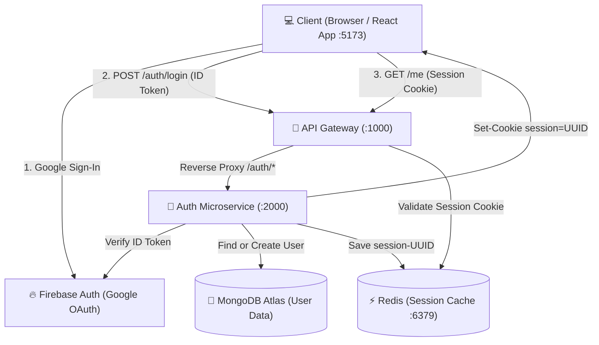
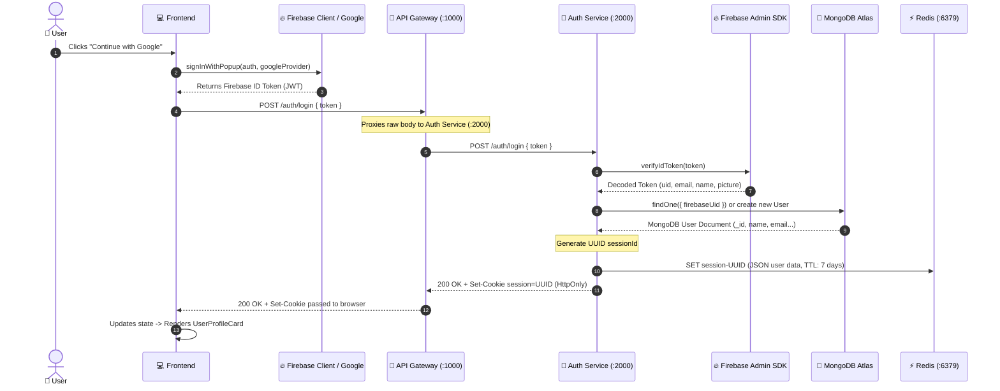
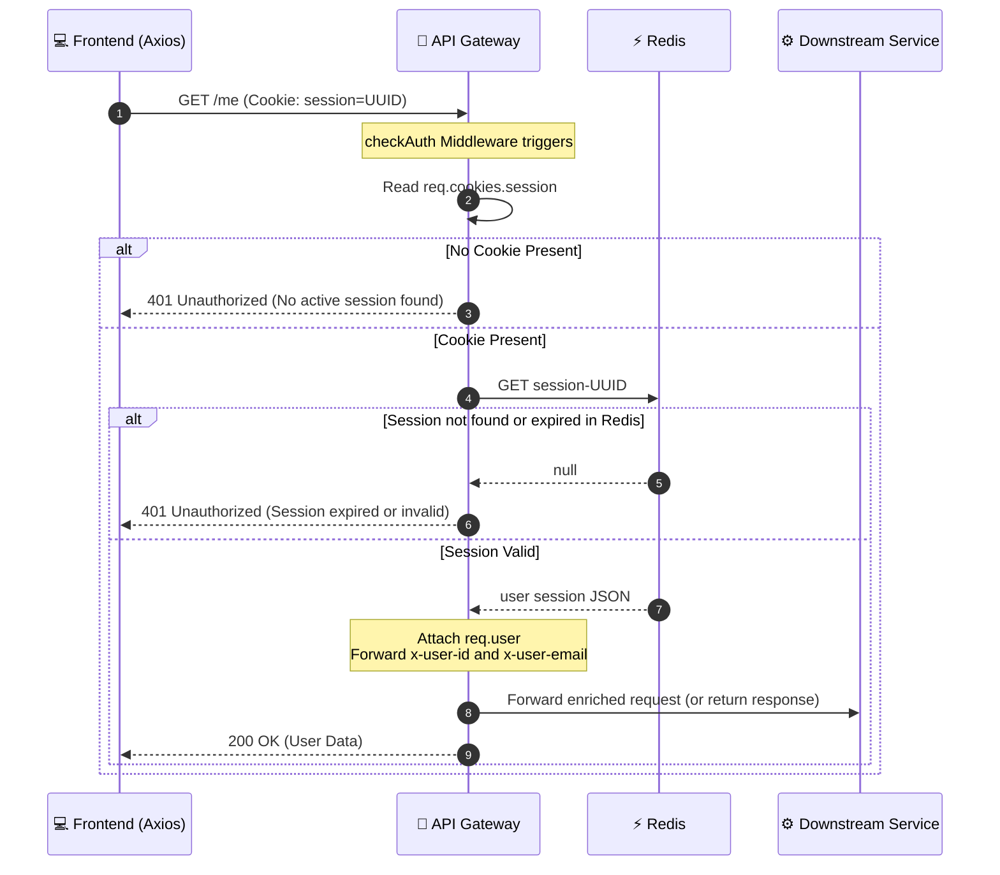

# Multi-Agent AI — Architecture & Code Flow Guide 🚀

A scalable, decoupled microservices-based AI system built with **Node.js**, **Express**, **Redis**, **MongoDB**, **Firebase Authentication**, and a modern **React + Vite** frontend.

---

## 📑 Table of Contents

1. [High-Level Architecture Diagram](#high-level-architecture-diagram)
2. [Folder Structure](#folder-structure)
3. [Core Services & Responsibilities](#core-services--responsibilities)
4. [End-to-End Authentication & Code Flows](#end-to-end-authentication--code-flows)
   - [1. User Login Flow](#1-user-login-flow)
   - [2. Gateway Route Protection (`checkAuth`)](#2-gateway-route-protection-checkauth)
   - [3. Auto-Login & Session Recovery (`getUser`)](#3-auto-login--session-recovery-getuser)
   - [4. Logout & Invalidation Flow](#4-logout--invalidation-flow)
5. [Redis Session Strategy](#redis-session-strategy)
6. [Standardized Responses & Global Error Handling](#standardized-responses--global-error-handling)
7. [Running the Application Locally](#running-the-application-locally)

---

## High-Level Architecture Diagram



---

## Folder Structure

```text
Multi Agent AI/
├── backend/
│   ├── docker-compose.yml              # Runs local Redis container (port 6379)
│   ├── package.json                    # Root backend package ("type": "module")
│   │
│   ├── gateway/                        # 🚪 API Gateway (Port 1000)
│   │   ├── index.js                    # Gateway entry point, CORS, proxy rules & protected routes
│   │   ├── package.json
│   │   ├── middleware/
│   │   │   └── auth.middleware.js      # checkAuth guard: checks Redis session cookie
│   │   └── .env                        # Gateway configuration (PORT=1000, AUTH_SERVICE URL)
│   │
│   ├── services/
│   │   └── auth/                       # 🔐 Auth Service (Port 2000)
│   │       ├── index.js                # Auth server entry point, mounts routes & error handling
│   │       ├── package.json
│   │       ├── config/
│   │       │   ├── db.js               # MongoDB connection (with DNS fix for Atlas)
│   │       │   ├── firebase.js         # Firebase Admin SDK initialization
│   │       │   └── serviceAccountKey.json # Firebase Admin credentials (gitignored)
│   │       ├── models/
│   │       │   └── auth.model.js       # Mongoose User Schema (firebaseUid, email, name, avatar)
│   │       ├── routes/
│   │       │   └── auth.route.js       # /login and /logout endpoints
│   │       ├── services/
│   │       │   └── auth.controller.js  # Login & Logout business logic
│   │       └── .env                    # Auth service env (PORT, MONGO_URI, REDIS_URL)
│   │
│   └── shared/                         # 📦 Shared Utilities (DRY & Single Source of Truth)
│       ├── redis/
│       │   └── redis.js                # Shared ioredis client singleton
│       ├── middleware/
│       │   └── error.middleware.js     # Global error handler (Mongoose, AppError, 404)
│       └── utils/
│           ├── AppError.js             # Custom operational error class (message, statusCode)
│           └── response.js             # sendSuccess, sendError, asyncHandler helpers
│
└── frontend/                           # 💻 React Frontend (Port 5173)
    ├── index.html
    ├── package.json
    ├── vite.config.js
    └── src/
        ├── main.jsx                    # React 19 root render
        ├── App.jsx                     # Top-level application shell
        ├── index.css                   # Tailwind CSS v4 & theme variables
        ├── pages/
        │   └── Home.jsx                # Landing page: toggles LoginCard / UserProfileCard
        ├── features/
        │   └── getUser.js              # Calls Gateway GET /me to restore session
        ├── components/
        │   ├── auth/
        │   │   ├── LoginCard.jsx       # Google Sign-In button card
        │   │   └── UserProfileCard.jsx # Active user details, avatar & sign-out button
        │   ├── icons/
        │   │   └── GoogleIcon.jsx      # Clean SVG Google icon
        │   └── ui/                     # Shadcn / Radix UI components (Button, Card, etc.)
        └── utils/
            ├── axios.js                # Axios client with baseURL=localhost:1000 & withCredentials
            └── firebase.js             # Firebase Client SDK (GoogleAuthProvider, signInWithPopup)
```

---

## Core Services & Responsibilities

| Service | Port | Primary Responsibility |
| :--- | :--- | :--- |
| **API Gateway** | `1000` | The single public-facing entry point. Handles CORS, parses cookies, proxies `/auth/*` to Auth Service via `express-http-proxy`, guards protected routes with `checkAuth`, and enriches downstream requests with `x-user-id` headers. |
| **Auth Service** | `2000` | Private microservice. Verifies Google ID tokens using Firebase Admin, syncs user records in MongoDB Atlas, creates 7-day session entries in Redis, and manages HTTP-only cookies. |
| **Shared Layer** | N/A | Centralized, reusable logic shared between microservices: `redis.js`, standardized response formats, `asyncHandler`, `AppError`, and global error handling. |
| **Frontend** | `5173` | React SPA. Uses Firebase Client SDK for popup authentication, communicates exclusively with the API Gateway, and auto-restores sessions on page reload via `getUser()`. |
| **Redis** | `6379` | High-performance in-memory session store. Provides instant session lookups for the Gateway without querying MongoDB on every request. |
| **MongoDB** | Cloud | Persistent datastore for user accounts, profiles, timestamps, and roles. |

---

## End-to-End Authentication & Code Flows

### 1. User Login Flow



---

### 2. Gateway Route Protection (`checkAuth`)

Any request to protected Gateway endpoints (e.g. `GET /me`) passes through [`backend/gateway/middleware/auth.middleware.js`](file:///w:/Multi%20Agent%20AI/backend/gateway/middleware/auth.middleware.js):



---

### 3. Auto-Login & Session Recovery (`getUser`)

When the user refreshes the browser tab, React memory is cleared. [`frontend/src/features/getUser.js`](file:///w:/Multi%20Agent%20AI/frontend/src/features/getUser.js) automatically restores the user session:

1. **`Home.jsx` mounts**: Triggers `useEffect()`.
2. **Calls `getUser()`**: Sends `GET http://localhost:1000/me` with `withCredentials: true`.
3. **Browser attaches cookie**: The HTTP-only `session` cookie is sent automatically.
4. **Gateway responds**:
   - If session is active in Redis $\rightarrow$ Returns `data: { userId, name, email, avatar }` $\rightarrow$ React sets `user` state and renders [`UserProfileCard.jsx`](file:///w:/Multi%20Agent%20AI/frontend/src/components/auth/UserProfileCard.jsx).
   - If session is missing or expired $\rightarrow$ Gateway returns `401` $\rightarrow$ `getUser()` catches it quietly and returns `null` $\rightarrow$ React stays on [`LoginCard.jsx`](file:///w:/Multi%20Agent%20AI/frontend/src/components/auth/LoginCard.jsx).

---

### 4. Logout & Invalidation Flow

1. User clicks **"Sign Out"** on [`UserProfileCard.jsx`](file:///w:/Multi%20Agent%20AI/frontend/src/components/auth/UserProfileCard.jsx).
2. Frontend calls `api.post("/auth/logout")`.
3. Gateway proxies request to `Auth Service` (`POST /auth/logout`).
4. Auth Service executes:
   ```javascript
   await redis.del(`session-${sessionId}`);
   res.clearCookie("session", { httpOnly: true, sameSite: "strict" });
   ```
5. Frontend signs out of Firebase client: `await signOut(auth);`.
6. Frontend clears state: `setUser(null)`.

---

## Redis Session Strategy

### Why Redis?
- **Speed**: In-memory lookups take `< 1ms`, allowing the Gateway to authenticate requests at high throughput without overloading MongoDB.
- **Microservice Decoupling**: Any microservice connected to Redis can read session state without making internal HTTP requests to the Auth service.
- **Automatic Expiration**: Native Redis `EX` TTL removes stale sessions automatically.

### Key Convention & Payload Schema
- **Key Format**: `session-<UUID>` (e.g. `session-550e8400-e29b-41d4-a716-446655440000`)
- **TTL**: `604800` seconds (7 days)
- **Stored Data (JSON)**:
  ```json
  {
    "userId": "6a9ee576c56cb6152941e0a9",
    "name": "Prince Sharma",
    "email": "prince@example.com",
    "avatar": "https://lh3.googleusercontent.com/..."
  }
  ```

---

## Standardized Responses & Global Error Handling

All backend responses follow a strict, unified contract in [`backend/shared/utils/response.js`](file:///w:/Multi%20Agent%20AI/backend/shared/utils/response.js):

### Success Format:
```json
{
  "success": true,
  "message": "Logged in successfully ✅",
  "data": { ... }
}
```

### Error Format:
```json
{
  "success": false,
  "message": "Email already exists",
  "error": "..." 
}
```
*(Stack traces are only included when `NODE_ENV=development`)*.

### Zero-Boilerplate Controllers (`asyncHandler` + `AppError`)
Instead of wrapping every controller in `try/catch` blocks:
```javascript
import { sendSuccess, asyncHandler, AppError } from "../../../shared/utils/response.js";

export const exampleController = asyncHandler(async (req, res) => {
  if (!req.body.title) {
    throw new AppError("Title is required", 400);
  }
  
  const item = await Item.create(req.body);
  return sendSuccess(res, item, "Created successfully", 201);
});
```

### What [`error.middleware.js`](file:///w:/Multi%20Agent%20AI/backend/shared/middleware/error.middleware.js) Catches Automatically:
1. **Mongoose `ValidationError`** $\rightarrow$ Returns `400 Bad Request` with field names.
2. **Mongoose `CastError` (Invalid ObjectId)** $\rightarrow$ Returns `404 Not Found`.
3. **Mongoose Duplicate Key (`11000`)** $\rightarrow$ Returns `409 Conflict` (e.g., `Email already exists`).
4. **Firebase / JWT Token Errors** $\rightarrow$ Returns `401 Unauthorized`.
5. **Operational Errors ([`AppError`](file:///w:/Multi%20Agent%20AI/backend/shared/utils/AppError.js))** $\rightarrow$ Uses designated message and status code.
6. **Unknown 500 Errors** $\rightarrow$ Safely logs error to console and returns generic message to client.
7. **Undefined Routes (`notFound`)** $\rightarrow$ Returns uniform `404 Route not found`.

---

## Running the Application Locally

### 1. Prerequisites
- [Node.js](https://nodejs.org/) (v18+ or v20+)
- [Docker](https://www.docker.com/) (for Redis)

### 2. Start Redis
```powershell
cd "w:\Multi Agent AI\backend"
docker compose up -d
```
*Redis will start in the background on port `6379`.*

### 3. Start the API Gateway
```powershell
cd "w:\Multi Agent AI\backend\gateway"
npm install
npm run dev
```
*Gateway will run on `http://localhost:1000`.*

### 4. Start the Auth Microservice
```powershell
cd "w:\Multi Agent AI\backend\services\auth"
npm install
npm run dev
```
*Auth Service will run on `http://localhost:2000`.*

### 5. Start the Frontend
```powershell
cd "w:\Multi Agent AI\frontend"
npm install
npm run dev
```
*Frontend will run on `http://localhost:5173`.*
