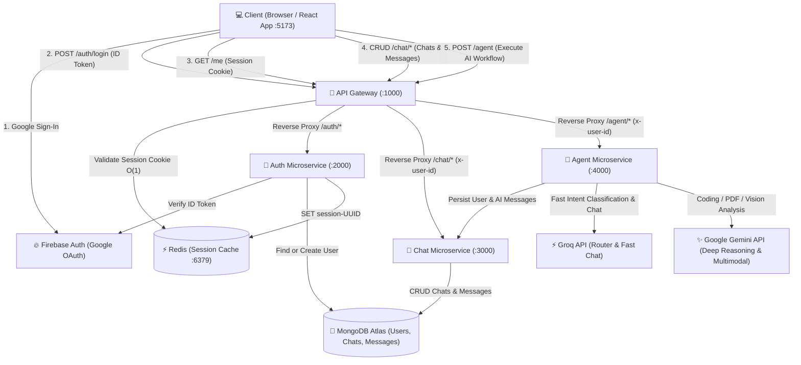

# Multi-Agent AI — Full Architecture & System Flow Guide 🚀

A scalable, decoupled microservices-based AI system built with **Node.js**, **Express**, **LangGraph**, **Redis**, **MongoDB Atlas**, **Firebase Authentication**, **Groq**, **Google Gemini**, and a modern **React + Vite** frontend.

---

## 📑 Table of Contents

1. [High-Level Architecture Diagram](#high-level-architecture-diagram)
2. [Workspace Directory Structure](#workspace-directory-structure)
3. [Core Services & Ports](#core-services--ports)
4. [End-to-End System Flows](#end-to-end-system-flows)
   - [1. User Authentication & Session Issuance](#1-user-authentication--session-issuance)
   - [2. Gateway Route Protection (`checkAuth`)](#2-gateway-route-protection-checkauth)
   - [3. Auto-Login & Session Recovery (`getUser`)](#3-auto-login--session-recovery-getuser)
   - [4. Conversation & Message Flow](#4-conversation--message-flow)
   - [5. LangGraph Multi-Agent AI Workflow](#5-langgraph-multi-agent-ai-workflow)
5. [Redis Session Strategy](#redis-session-strategy)
6. [Standardized Responses & Global Error Handling](#standardized-responses--global-error-handling)
7. [Running the Application Locally](#running-the-application-locally)
8. [Backend In-Depth Documentation](#backend-in-depth-documentation)

---

## High-Level Architecture Diagram



---

## Workspace Directory Structure

```text
Multi Agent AI/
├── start-dev.bat                   # 1-Click launcher for all 6 processes
├── stop-all.bat                    # 1-Click shutdown for all processes
├── package.json                    # Root scripts (npm run dev, dev:backend)
│
├── backend/
│   ├── BACKEND_ARCHITECTURE.md     # 🧠 In-depth backend architecture guide
│   ├── docker-compose.yml          # Redis container configuration (:6379)
│   ├── package.json
│   │
│   ├── gateway/                    # 🚪 API Gateway (Port 1000)
│   │   ├── index.js                # Gateway entry, CORS, proxy rules & protected routes
│   │   ├── middleware/auth.middleware.js # checkAuth: verifies Redis session cookie
│   │   └── .env
│   │
│   ├── services/
│   │   ├── auth/                   # 🔐 Auth Service (Port 2000)
│   │   │   ├── index.js            # Auth entry point
│   │   │   ├── config/             # MongoDB connection & Firebase Admin SDK
│   │   │   ├── models/auth.model.js# User Schema (firebaseUid, email, name, avatar, role)
│   │   │   ├── routes/auth.route.js# POST /login, POST /logout
│   │   │   └── services/auth.controller.js # Auth business logic
│   │   │
│   │   ├── chat/                   # 💬 Chat Service (Port 3000)
│   │   │   ├── index.js            # Chat entry point
│   │   │   ├── configs/db.js       # MongoDB connection
│   │   │   ├── models/             # chat.model.js, message.model.js
│   │   │   ├── controllers/chat.controller.js # CRUD & cascading message deletions
│   │   │   └── routes/chat.route.js# / (list/create), /:chatId (get/put/delete), /:chatId/messages
│   │   │
│   │   └── agent/                  # 🤖 Agent Service (Port 4000)
│   │       ├── index.js            # Agent entry point
│   │       ├── configs/llmModel.js # Groq & Google Gemini client setup
│   │       ├── graph/              # LangGraph state, router, and workflow graph
│   │       ├── agents/             # Specialist agents (chat, coding, search, imageGen, pdf, ppt)
│   │       ├── controllers/agent.controller.js # Graph invocation & message persistence
│   │       └── routes/agent.route.js # POST / and POST /prompt
│   │
│   └── shared/                     # 📦 Shared Utilities (DRY layer)
│       ├── redis/redis.js          # Shared ioredis client singleton
│       ├── middleware/error.middleware.js # Global error handler
│       └── utils/
│           ├── AppError.js         # Custom operational error class
│           └── response.js         # Standardized sendSuccess, sendError, asyncHandler
│
└── frontend/                       # 💻 React Frontend (Port 5173)
    ├── index.html
    ├── package.json
    ├── vite.config.js
    └── src/
        ├── App.jsx                 # Top-level shell
        ├── redux/                  # Redux Toolkit store & slices (chats, messages, user)
        ├── components/
        │   ├── chat/               # Chat.jsx, ChatNav.jsx, ChatMsg.jsx, ChatInput.jsx
        │   ├── sidebar/            # Sidebar.jsx, ChatList.jsx
        │   └── auth/               # LoginCard.jsx, UserProfileCard.jsx
        └── utils/axios.js          # Axios client (baseURL: localhost:1000, withCredentials: true)
```

---

## Core Services & Ports

| Service | Port | Primary Responsibility |
| :--- | :--- | :--- |
| **API Gateway** | `1000` | Single entry point. Handles CORS, verifies session cookies via Redis, reverse proxies `/auth/*`, `/chat/*`, and `/agent/*`, and decorates requests with `x-user-id` and `x-user-email`. |
| **Auth Service** | `2000` | Verifies Google ID tokens via Firebase Admin, syncs user records in MongoDB Atlas, creates 7-day session records in Redis, and sets HTTP-only cookies. |
| **Chat Service** | `3000` | Manages conversation threads and message histories in MongoDB Atlas. Enforces user ownership and performs cascading deletes. |
| **Agent Service** | `4000` | Multi-agent orchestration engine powered by LangGraph. Routes user queries to specialist agents (chat, coding, search, pdf, ppt, vision) and auto-persists conversation turns. |
| **Redis** | `6379` | High-performance in-memory session cache. Enables sub-millisecond session validation at the Gateway without querying MongoDB. |
| **MongoDB** | Cloud | Persistent cloud datastore for `users`, `chats`, and `messages` collections. |
| **Frontend** | `5173` | React 19 SPA with Redux Toolkit and Tailwind CSS. Communicates exclusively with the API Gateway. |

---

## End-to-End System Flows

### 1. User Authentication & Session Issuance
1. User clicks "Continue with Google" on the Frontend.
2. Firebase Client SDK triggers Google OAuth popup and returns an ID Token (JWT).
3. Frontend sends `POST http://localhost:1000/auth/login` with `{ token }`.
4. Gateway proxies request to Auth Service (:2000).
5. Auth Service validates token via Firebase Admin SDK.
6. Auth Service finds or creates a user record in MongoDB Atlas.
7. Auth Service generates a random UUID `sessionId`, writes it to Redis (`session-<UUID>`, TTL 7 days), and sets an HTTP-only `session` cookie.
8. User is logged in and redirected to the main chat interface.

---

### 2. Gateway Route Protection (`checkAuth`)
Every request targeting `/chat/*`, `/agent/*`, or `/me` passes through [`backend/gateway/middleware/auth.middleware.js`](file:///w:/Multi%20Agent%20AI/backend/gateway/middleware/auth.middleware.js):
- Reads the `session` cookie.
- Performs an $O(1)$ query on Redis for `session-<UUID>`.
- If valid $\rightarrow$ Attaches user session data and sets headers `x-user-id` and `x-user-email` for downstream microservices.
- If missing or invalid $\rightarrow$ Rejects immediately with `401 Unauthorized` before any downstream service or database is touched.

---

### 3. Auto-Login & Session Recovery (`getUser`)
When a user refreshes the browser:
1. `getUser()` sends `GET http://localhost:1000/me` with `withCredentials: true`.
2. Gateway verifies the Redis session and returns the user's profile.
3. React Redux store hydrates the active user state seamlessly.

---

### 4. Conversation & Message Flow
1. **Thread Initialization**: Frontend calls `POST /chat` with `{ title }`. Chat Service persists a new `Chat` document associated with `x-user-id`.
2. **Retrieving Messages**: Frontend calls `GET /chat/:chatId/messages`. Chat Service returns all messages ordered by `createdAt: 1`.
3. **Deleting Conversations**: Calling `DELETE /chat/:chatId` deletes both the `Chat` document and all matching `Message` documents via `Message.deleteMany({ chatId })`.

---

### 5. LangGraph Multi-Agent AI Workflow
When a prompt is submitted from [`ChatInput.jsx`](file:///w:/Multi%20Agent%20AI/frontend/src/components/chat/ChatInput.jsx):
1. Client sends `POST /agent` with `{ prompt, chatId }`.
2. Gateway verifies session and proxies to Agent Service (:4000).
3. **Persistence (Turn 1)**: Agent controller saves the user prompt to Chat Service as `{ role: "user", content: prompt }`.
4. **LangGraph State Machine**:
   - **Router Node**: Groq classifies the query into one of: `chat`, `search`, `coding`, `pdf`, `ppt`, or `vision`.
   - **Specialist Node**: The designated agent executes. For live search queries, `searchAgent` feeds factual findings into `chatAgent` for synthesis.
5. **Persistence (Turn 2)**: Agent controller saves the generated response to Chat Service as `{ role: "assistant", content: aiResponse }`.
6. Returns the completed payload `{ agent, prompt, aiResponse, chatId, message }` to the client.

---

## Redis Session Strategy

- **Speed**: In-memory lookups take `< 1ms`, allowing the Gateway to authenticate high-volume traffic without database strain.
- **Key Pattern**: `session-<UUID>` (e.g. `session-8b7f8c12-5a21-4f32-84b2-65a8df35b440`)
- **TTL**: `604800` seconds (7 days) with automatic eviction.
- **Payload**:
  ```json
  {
    "userId": "67cd6b819f01e194e82b75a1",
    "name": "Prince Sharma",
    "email": "prince@example.com",
    "avatar": "https://lh3.googleusercontent.com/..."
  }
  ```

---

## Standardized Responses & Global Error Handling

All services conform to the standard response contract in [`backend/shared/utils/response.js`](file:///w:/Multi%20Agent%20AI/backend/shared/utils/response.js):

```json
// Success
{ "success": true, "message": "Success", "data": { ... } }

// Error
{ "success": false, "message": "Something went wrong", "error": "..." }
```

### Global Error Classification:
- **Mongoose `CastError`** $\rightarrow$ `404 Resource not found with invalid id`
- **Mongoose Duplicate Key (`11000`)** $\rightarrow$ `409 Conflict`
- **Mongoose `ValidationError`** $\rightarrow$ `400 Bad Request` with field details
- **Firebase / JWT Errors** $\rightarrow$ `401 Unauthorized`
- **Operational Errors (`AppError`)** $\rightarrow$ Designated message and status code

---

## Running the Application Locally

### 1-Click Dev Launcher (Windows)
Double click [`start-dev.bat`](file:///w:/Multi%20Agent%20AI/start-dev.bat) to launch all 6 services simultaneously:
- Redis (`6379`)
- API Gateway (`1000`)
- Auth Service (`2000`)
- Chat Service (`3000`)
- Agent Service (`4000`)
- React Frontend (`5173`)

To stop all running processes: Run [`stop-all.bat`](file:///w:/Multi%20Agent%20AI/stop-all.bat).

### Terminal Commands (Concurrently)
```bash
# Start backend services + Redis
npm run dev:backend

# Start full stack (all backend + frontend)
npm run dev
```

---

## Backend In-Depth Documentation

For detailed internal documentation including model schemas, LangGraph node specifications, inter-service contracts, and the future engineering roadmap, refer to:

👉 **[`backend/BACKEND_ARCHITECTURE.md`](file:///w:/Multi%20Agent%20AI/backend/BACKEND_ARCHITECTURE.md)**
