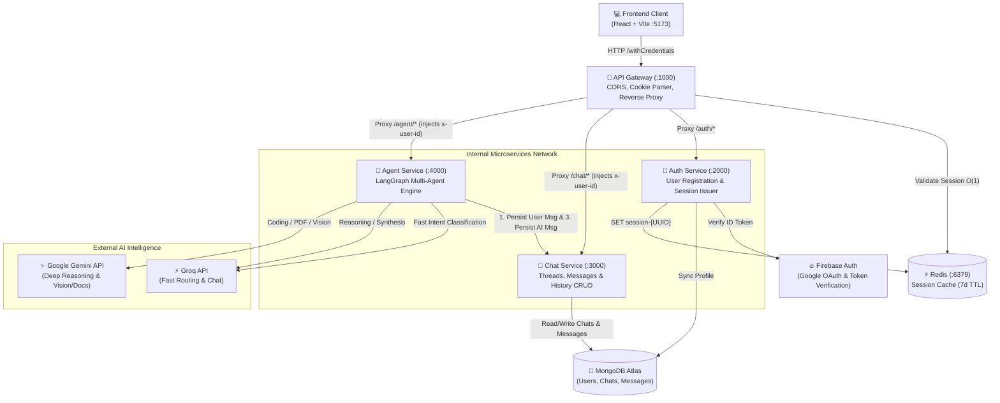
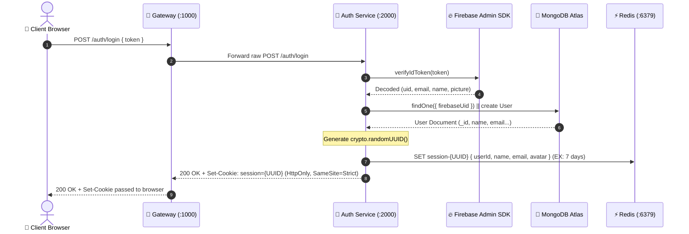

# Multi-Agent AI — Backend Architecture & Code Flow Master Guide 🧠⚙️

> **Single Source of Truth** for the backend architecture, service topology, data flow, LangGraph multi-agent orchestration, database schemas, and engineering roadmap for the Multi-Agent AI platform.

---

## 📑 Table of Contents

1. [System Architectural Overview](#-system-architectural-overview)
2. [End-to-End System Topology Diagram](#-end-to-end-system-topology-diagram)
3. [Backend Directory & File Inventory](#-backend-directory--file-inventory)
4. [Cross-Cutting Shared Layer (`backend/shared`)](#-cross-cutting-shared-layer-backendshared)
   - [Redis Singleton (`redis.js`)](#1-redis-singleton-redisjs)
   - [Standardized Response System (`response.js`)](#2-standardized-response-system-responsejs)
   - [Custom Error Handling (`AppError.js`)](#3-custom-error-handling-apperrorjs)
   - [Global Error Middleware (`error.middleware.js`)](#4-global-error-middleware-errormiddlewarejs)
5. [Service Deep Dive: API Gateway (:1000)](#-service-deep-dive-api-gateway-1000)
   - [Reverse Proxy Routing & Header Injection](#reverse-proxy-routing--header-injection)
   - [Authentication Guard (`checkAuth`)](#authentication-guard-checkauth)
6. [Service Deep Dive: Auth Microservice (:2000)](#-service-deep-dive-auth-microservice-2000)
   - [Authentication & Session Flow](#authentication--session-flow)
   - [User Model & Datastore](#user-model--datastore)
7. [Service Deep Dive: Chat Microservice (:3000)](#-service-deep-dive-chat-microservice-3000)
   - [Chat & Message Data Models](#chat--message-data-models)
   - [Conversation Lifecycle & Cascading Deletion](#conversation-lifecycle--cascading-deletion)
8. [Service Deep Dive: Agent Microservice (:4000)](#-service-deep-dive-agent-microservice-4000)
   - [Dual LLM Strategy (Groq + Google Gemini)](#dual-llm-strategy-groq--google-gemini)
   - [LangGraph Orchestration & State Machine](#langgraph-orchestration--state-machine)
   - [Specialist Agents Catalog](#specialist-agents-catalog)
   - [Search-Augmented Synthesis Pipeline](#search-augmented-synthesis-pipeline)
   - [Agent Controller Lifecycle](#agent-controller-lifecycle)
9. [Complete API Contract Reference](#-complete-api-contract-reference)
10. [Data Schemas & Storage Specifications](#-data-schemas--storage-specifications)
11. [Local Development & Environment Setup](#-local-development--environment-setup)
12. [In-Depth Improvement & Production Roadmap](#-in-depth-improvement--production-roadmap)

---

## 🏛️ System Architectural Overview

The backend is built as a **decoupled, microservices-oriented distributed system** designed for high throughput, low latency, and modular AI agent execution:

- **Single Entry Point**: The **API Gateway (`:1000`)** intercepts all client requests, verifies session credentials via Redis in `< 1ms`, and proxies traffic to private downstream services.
- **Zero-Trust Downstream Services**: Private microservices do not read cookies directly. The Gateway verifies the cookie against Redis, extracts user identity, and forwards sanitized identity headers (`x-user-id`, `x-user-email`) to downstream services.
- **Hybrid Storage Strategy**:
  - **Redis (`:6379`)**: In-memory caching for session management (7-day TTL) and fast O(1) credential validation.
  - **MongoDB Atlas**: Persistent cloud document datastore for users, conversations, and chat histories.
- **Multi-Agent AI Engine**: Orchestrated with **LangGraph** (`@langchain/langgraph`), utilizing **Groq** for high-speed intent routing and fast chat generation, and **Google Gemini** for deep contextual reasoning, multimodal analysis, and document parsing.

---

## 🗺️ End-to-End System Topology Diagram



---

## 📁 Backend Directory & File Inventory

```text
backend/
├── docker-compose.yml              # Local Redis container configuration (port 6379)
├── package.json                    # Backend root configuration ("type": "module")
│
├── gateway/                        # 🚪 API Gateway (Port 1000)
│   ├── .env                        # PORT, AUTH_SERVICE, CHAT_SERVICE, AGENT_SERVICE, REDIS_URL
│   ├── index.js                    # Server bootstrap, CORS, proxy rules, /me, error handlers
│   ├── package.json                # Dependencies: express, express-http-proxy, cookie-parser, cors
│   └── middleware/
│       └── auth.middleware.js      # checkAuth guard: extracts session cookie, checks Redis, sets headers
│
├── services/
│   ├── auth/                       # 🔐 Authentication Microservice (Port 2000)
│   │   ├── .env                    # PORT, MONGO_URI, REDIS_URL
│   │   ├── index.js                # Auth server bootstrap & route mounting
│   │   ├── package.json            # Dependencies: firebase-admin, mongoose, ioredis, express
│   │   ├── config/
│   │   │   ├── db.js               # MongoDB connection with DNS fallback (8.8.8.8, 1.1.1.1)
│   │   │   ├── firebase.js         # Firebase Admin SDK initialization
│   │   │   └── serviceAccountKey.json # Firebase Admin credentials (gitignored)
│   │   ├── models/
│   │   │   └── auth.model.js       # User Mongoose Schema (firebaseUid, name, email, avatar, role)
│   │   ├── routes/
│   │   │   └── auth.route.js       # POST /login, POST /logout
│   │   └── services/
│   │       └── auth.controller.js  # Firebase token verification, MongoDB upsert, Redis session issue
│   │
│   ├── chat/                       # 💬 Chat & Conversation Microservice (Port 3000)
│   │   ├── .env                    # PORT, MONGO_URI, DB_NAME
│   │   ├── index.js                # Chat server bootstrap & route mounting (/chat, /chats, /)
│   │   ├── package.json            # Dependencies: mongoose, express, cookie-parser
│   │   ├── configs/
│   │   │   └── db.js               # MongoDB Atlas connection
│   │   ├── models/
│   │   │   ├── chat.model.js       # Chat Mongoose Schema (title, userId, lastMessage, timestamps)
│   │   │   └── message.model.js    # Message Mongoose Schema (chatId, senderId, role, content)
│   │   ├── controllers/
│   │   │   └── chat.controller.js  # CRUD for chats, messages, cascading deletes, ownership check
│   │   └── routes/
│   │       └── chat.route.js       # Routes: / (list/create), /:chatId (get/put/delete), /:chatId/messages
│   │
│   └── agent/                      # 🤖 Agent Orchestration Microservice (Port 4000)
│       ├── .env                    # PORT, GROQ_API_KEY, GOOGLE_API_KEY, CHAT_SERVICE
│       ├── index.js                # Agent server bootstrap & route mounting
│       ├── package.json            # Dependencies: @langchain/langgraph, @langchain/groq, @langchain/google-genai, axios
│       ├── configs/
│       │   └── llmModel.js         # Groq and Gemini clients & dynamic model selector getModel(agent)
│       ├── graph/
│       │   ├── states.js           # LangGraph State definition: { prompt, aiResponse, agent, chatId }
│       │   ├── router.js           # Fast intent classification node using Groq
│       │   └── graph.js            # StateGraph definition: nodes, conditional edges, search synthesis edge
│       ├── agents/
│       │   ├── index.js            # Agent module barrel export
│       │   ├── chat.agent.js       # Sarathi AI general conversation & synthesis agent
│       │   ├── coding.agent.js     # Code generation & debugging specialist agent
│       │   ├── search.agent.js     # Real-time web retrieval & search specialist agent
│       │   ├── imageGen.agent.js   # Image generation & visual design specialist agent
│       │   ├── pdf.agent.js        # PDF document parsing & analysis specialist agent
│       │   └── ppt.agent.js        # Presentation & slide deck creation specialist agent
│       ├── controllers/
│       │   └── agent.controller.js # Persists user prompt, invokes LangGraph, persists AI response
│       └── routes/
│           └── agent.route.js      # POST / and POST /prompt
│
└── shared/                         # 📦 Cross-Cutting Reusable Utilities
    ├── redis/
    │   └── redis.js                # Shared ioredis client singleton
    ├── middleware/
    │   └── error.middleware.js     # Global 404 handler and error classifier (Mongoose, JWT, 500)
    └── utils/
        ├── AppError.js             # Custom operational error class with status codes
        └── response.js             # Standardized sendSuccess, sendError, and asyncHandler wrapper
```

---

## 📦 Cross-Cutting Shared Layer (`backend/shared`)

The `backend/shared` directory centralizes infrastructure common across microservices to maintain DRY principles and uniform response signatures.

### 1. Redis Singleton (`redis.js`)
- Initializes `ioredis` pointing to `process.env.REDIS_URL || "redis://localhost:6379"`.
- Logs explicit connection status (`Redis Connected ✅` or `Redis Connection Error ❌`).
- Used by Gateway (for session validation) and Auth Service (for session generation and revocation).

### 2. Standardized Response System (`response.js`)
All microservices emit responses conforming to an identical JSON contract:

```javascript
// Success Response
sendSuccess(res, data = null, message = "Success", statusCode = 200)
// Emits:
{
  "success": true,
  "message": "...",
  "data": { ... }
}

// Error Response
sendError(res, message = "Something went wrong", statusCode = 500, error = null)
// Emits:
{
  "success": false,
  "message": "...",
  "error": "..."
}

// Async Handler Wrapper
export const asyncHandler = (fn) => (req, res, next) => {
  Promise.resolve(fn(req, res, next)).catch(next);
};
```

### 3. Custom Error Handling (`AppError.js`)
Represents intentional, operational errors (such as invalid user input or unauthorized access) distinct from unexpected programming crashes:
```javascript
export class AppError extends Error {
  constructor(message, statusCode = 500) {
    super(message);
    this.statusCode = statusCode;
    this.isOperational = true;
    Error.captureStackTrace(this, this.constructor);
  }
}
```

### 4. Global Error Middleware (`error.middleware.js`)
Catches uncaught errors and formats them into client-friendly responses without crashing the process:
- **`notFound`**: Generates a 404 `AppError` for unmatched routes.
- **`errorHandler`**:
  - **Mongoose `CastError`**: Converts bad ObjectIds to `404 Resource not found with invalid id`.
  - **Mongoose Duplicate Key (`11000`)**: Converts duplicate index collisions to `409 Conflict`.
  - **Mongoose `ValidationError`**: Concatenates validation messages with `400 Bad Request`.
  - **Firebase & JWT Errors**: Identifies token expiry or invalid signature with `401 Unauthorized`.
  - **500 Server Errors**: Hides internal stack traces in production while logging them to server console.

---

## 🚪 Service Deep Dive: API Gateway (:1000)

The API Gateway is the central reverse proxy protecting and orchestrating all downstream microservices.

### Reverse Proxy Routing & Header Injection
Implemented with `express-http-proxy`. Crucially, `parseReqBody: false` is configured on proxies so that Node 20+ streams request bodies directly without double-buffering.

```javascript
// Chat Service Proxy
app.use(
  ["/chat", "/chats"],
  checkAuth,
  proxy(process.env.CHAT_SERVICE || "http://localhost:3000", {
    parseReqBody: false,
    proxyReqOptDecorator: (proxyReqOpts, srcReq) => {
      proxyReqOpts.headers["x-user-id"] = srcReq.user?.userId || "";
      proxyReqOpts.headers["x-user-email"] = srcReq.user?.email || "";
      return proxyReqOpts;
    },
  })
);

// Agent Service Proxy
app.use(
  "/agent",
  checkAuth,
  proxy(process.env.AGENT_SERVICE || "http://localhost:4000", {
    parseReqBody: false,
    proxyReqOptDecorator: (proxyReqOpts, srcReq) => {
      proxyReqOpts.headers["x-user-id"] = srcReq.user?.userId || "";
      proxyReqOpts.headers["x-user-email"] = srcReq.user?.email || "";
      return proxyReqOpts;
    },
  })
);
```

### Authentication Guard (`checkAuth`)
Located in [`backend/gateway/middleware/auth.middleware.js`](file:///w:/Multi%20Agent%20AI/backend/gateway/middleware/auth.middleware.js):
1. Reads `req.cookies?.session`. If missing $\rightarrow$ Returns `401 Unauthorized`.
2. Queries Redis for key `session-${sessionId}`.
3. If not found or expired $\rightarrow$ Returns `401 Unauthorized`.
4. Parses session payload, attaches `req.user = user`, and decorates `req.headers["x-user-id"]` and `req.headers["x-user-email"]`.
5. Calls `next()` to proceed to proxy.

---

## 🔐 Service Deep Dive: Auth Microservice (:2000)

The Auth Service manages identity verification, database synchronization, and session issuance.

### Authentication & Session Flow


### User Model & Datastore
Defined in [`backend/services/auth/models/auth.model.js`](file:///w:/Multi%20Agent%20AI/backend/services/auth/models/auth.model.js):
- **Collection**: `users`
- **Fields**:
  - `firebaseUid`: `{ type: String, required: true, unique: true, index: true }`
  - `name`: `{ type: String, trim: true, default: "" }`
  - `email`: `{ type: String, required: true, unique: true, lowercase: true, index: true }`
  - `avatar`: `{ type: String, default: "" }`
  - `role`: `{ type: String, enum: ["user", "admin"], default: "user" }`
  - `timestamps`: `true` (`createdAt`, `updatedAt`)

---

## 💬 Service Deep Dive: Chat Microservice (:3000)

The Chat Service manages persistent conversation threads and individual messages in MongoDB Atlas.

### Chat & Message Data Models

#### 1. Chat Schema (`chats` collection)
```javascript
{
  title: { type: String, trim: true, default: "New Chat" },
  userId: { type: mongoose.Schema.Types.ObjectId, ref: "User", required: true, index: true },
  lastMessage: { type: String, default: "" },
  createdAt: ISODate,
  updatedAt: ISODate
}
```

#### 2. Message Schema (`messages` collection)
```javascript
{
  chatId: { type: mongoose.Schema.Types.ObjectId, ref: "Chat", required: true, index: true },
  senderId: { type: String, required: true },
  role: { type: String, enum: ["user", "assistant"], default: "user" },
  content: { type: String, required: true },
  createdAt: ISODate,
  updatedAt: ISODate
}
```

### Conversation Lifecycle & Cascading Deletion
- **Thread Creation**: User invokes `POST /chat` with optional `{ title }`. `userId` is extracted from `x-user-id`.
- **Saving Messages**: Calling `POST /:chatId/messages` creates a new `Message` record and automatically synchronizes the parent `Chat.lastMessage` field and updates `updatedAt`.
- **Ownership Verification**: All `GET /:chatId`, `PUT /:chatId`, and `DELETE /:chatId` endpoints verify that `chat.userId.toString() === req.headers["x-user-id"]`. If mismatch $\rightarrow$ returns `403 Forbidden`.
- **Cascading Deletion**: When `DELETE /:chatId` executes:
  ```javascript
  await Chat.findByIdAndDelete(chatId);
  await Message.deleteMany({ chatId });
  ```
  This guarantees zero orphaned message records in the database.

---

## 🤖 Service Deep Dive: Agent Microservice (:4000)

The Agent Service is the core AI intelligence engine, orchestrating multi-agent collaboration using LangGraph.

### Dual LLM Strategy (Groq + Google Gemini)
Defined in [`backend/services/agent/configs/llmModel.js`](file:///w:/Multi%20Agent%20AI/backend/services/agent/configs/llmModel.js):

| Model Client | Engine / Model Identifier | Primary Optimization | Assigned Agents |
| :--- | :--- | :--- | :--- |
| **Groq (`ChatGroq`)** | `openai/gpt-oss-120b` / `llama-3.3-70b-versatile` | Ultra-low latency inference (< 500ms TTFT) | `router`, `chat`, `search`, `ppt` |
| **Google Gemini (`ChatGoogleGenerativeAI`)** | `gemini-flash-latest` / `gemini-1.5-flash` | Large token context, multimodal vision, complex code reasoning | `coding`, `pdf`, `vision` |

Dynamic dispatch helper `getModel(agent)`:
```javascript
export const getModel = (agent) => {
  switch (agent) {
    case "coding":
    case "pdf":
    case "vision":
      return gemini;
    case "chat":
    case "search":
    case "ppt":
    default:
      return groq;
  }
};
```

### LangGraph Orchestration & State Machine

```mermaid
graph TD
    Start([__START__]) --> Router[🧭 Router Node<br/>Classifies intent via Groq]

    Router -.->|"agent == 'chat'"| ChatNode[💬 Chat Agent (Sarathi AI)]
    Router -.->|"agent == 'search'"| SearchNode[🔍 Search Agent]
    Router -.->|"agent == 'coding'"| CodingNode[💻 Coding Agent]
    Router -.->|"agent == 'pdf'"| PDFNode[📄 PDF Agent]
    Router -.->|"agent == 'ppt'"| PPTNode[📊 PPT Agent]
    Router -.->|"agent == 'vision'"| VisionNode[🎨 Vision / ImageGen Agent]

    %% Search Augmented Synthesis Edge
    SearchNode -->|"Pipes findings to aiResponse"| ChatNode

    %% Terminal Edges
    ChatNode --> Finish([__END__])
    CodingNode --> Finish
    PDFNode --> Finish
    PPTNode --> Finish
    VisionNode --> Finish
```

#### 1. Graph State Schema (`states.js`)
```javascript
export const agentState = Annotation.Root({
  prompt: Annotation(),      // Raw user prompt input
  aiResponse: Annotation(),  // Working response / intermediate synthesis
  agent: Annotation(),       // Detected specialist agent classification
  chatId: Annotation(),      // Active chat thread identifier
});
```

#### 2. Router Node (`router.js`)
The router analyzes the user prompt with a strict classification prompt and maps it to one of six agents:
- `coding`: Programming, debugging, implementation, refactoring.
- `search`: Live real-time facts, current news, sports, weather, web queries.
- `ppt`: Slide decks, presentations, outlines.
- `pdf`: Document parsing, analysis, extraction.
- `vision`: Image generation, artwork, drawing, graphics.
- `chat`: Conceptual discussion, Q&A, general conversation.

### Specialist Agents Catalog

| Agent File | Status | Description & Role |
| :--- | :--- | :--- |
| [`chat.agent.js`](file:///w:/Multi%20Agent%20AI/backend/services/agent/agents/chat.agent.js) | **Fully Active** | "Sarathi AI" core persona. Ingests system instructions and synthesizes web findings if provided by `searchAgent`. |
| [`coding.agent.js`](file:///w:/Multi%20Agent%20AI/backend/services/agent/agents/coding.agent.js) | Scaffold | Generates code, explains algorithms, and resolves bugs. |
| [`search.agent.js`](file:///w:/Multi%20Agent%20AI/backend/services/agent/agents/search.agent.js) | Scaffold | Performs internet queries and feeds real-time context into `chat.agent.js`. |
| [`imageGen.agent.js`](file:///w:/Multi%20Agent%20AI/backend/services/agent/agents/imageGen.agent.js) | Scaffold | Generates images from textual prompts. Aliased as `visionAgent`. |
| [`pdf.agent.js`](file:///w:/Multi%20Agent%20AI/backend/services/agent/agents/pdf.agent.js) | Scaffold | Extracts text and performs Q&A over PDF documents. |
| [`ppt.agent.js`](file:///w:/Multi%20Agent%20AI/backend/services/agent/agents/ppt.agent.js) | Scaffold | Outlines and constructs presentation slide decks. |

### Search-Augmented Synthesis Pipeline
The graph defines a unique architectural edge:
```javascript
workflow.addEdge("search", "chat");
```
When the user asks a real-time question:
1. `router` directs workflow to `searchAgent`.
2. `searchAgent` gathers factual context and stores it in `state.aiResponse`.
3. The graph automatically routes from `searchAgent` into `chatAgent`.
4. `chatAgent` injects `state.aiResponse` as a system context prompt:
   ```javascript
   if (aiResponse) {
     messages.push({
       role: "system",
       content: `Context / Search findings from web:\n${aiResponse}\n\nPlease use this information to synthesize a comprehensive, accurate answer for the user.`,
     });
   }
   ```
5. Sarathi AI delivers a synthesized, factual final response to the user.

### Agent Controller Lifecycle
When the client calls `POST /agent` (via Gateway):
1. **Persist User Message**: If `chatId` is present, executes `axios.post(`${chatServiceUrl}/${chatId}/messages`, { role: "user", content: prompt })`.
2. **Invoke Graph**: Runs `const graphResult = await graph.invoke({ prompt: prompt.trim() })`.
3. **Persist Assistant Message**: Executes `axios.post(`${chatServiceUrl}/${chatId}/messages`, { role: "assistant", content: graphResult.aiResponse })`.
4. **Respond**: Returns `{ agent, prompt, aiResponse, chatId, message }`.

---

## 📋 Complete API Contract Reference

### 1. API Gateway (`:1000`)
| Method | Route | Auth Guard | Description |
| :--- | :--- | :--- | :--- |
| `GET` | `/health` | Public | Gateway health check |
| `GET` | `/me` | `checkAuth` | Returns active user session data from Redis |
| `ALL` | `/auth/*` | Public | Reverse proxies to Auth Service (`:2000`) |
| `ALL` | `/chat/*`, `/chats/*` | `checkAuth` | Injects `x-user-id`, proxies to Chat Service (`:3000`) |
| `ALL` | `/agent/*` | `checkAuth` | Injects `x-user-id`, proxies to Agent Service (`:4000`) |

### 2. Auth Service (`:2000`)
| Method | Route | Access | Payload | Response |
| :--- | :--- | :--- | :--- | :--- |
| `GET` | `/health` | Public | None | Health status object |
| `POST` | `/login` | Public | `{ "token": "<Firebase_ID_Token>" }` | User document + sets `session` cookie |
| `POST` | `/logout` | Public | None (reads `session` cookie) | Clears cookie and deletes Redis session key |

### 3. Chat Service (`:3000`)
| Method | Route | Required Header | Payload | Description |
| :--- | :--- | :--- | :--- | :--- |
| `GET` | `/health` | None | None | Health status |
| `GET` | `/test` | None | None | Echoes received `x-user-id` and `x-user-email` headers |
| `GET` | `/` or `/chat` | `x-user-id` | None | Lists all user chats (sorted `updatedAt: -1`) |
| `POST` | `/` or `/chat` | `x-user-id` | `{ "title": "New Chat" }` | Creates a new chat thread |
| `GET` | `/:chatId` | `x-user-id` | None | Retrieves a chat by ID (verifies ownership) |
| `PUT` | `/:chatId` | `x-user-id` | `{ "title": "Updated Title" }` | Updates chat title |
| `DELETE` | `/:chatId` | `x-user-id` | None | Deletes chat and all associated messages |
| `GET` | `/:chatId/messages` | None | None | Retrieves all messages in chronological order |
| `POST` | `/:chatId/messages` | `x-user-id` | `{ "role": "user"\|"assistant", "content": "..." }` | Appends a message & updates `lastMessage` |

### 4. Agent Service (`:4000`)
| Method | Route | Required Header | Payload | Description |
| :--- | :--- | :--- | :--- | :--- |
| `GET` | `/health` | None | None | Health status |
| `POST` | `/` or `/prompt` | `x-user-id` | `{ "prompt": "...", "chatId": "..." }` | Executes LangGraph multi-agent flow & saves messages |

---

## 💾 Data Schemas & Storage Specifications

### Redis Key-Value Store
- **Key Pattern**: `session-<UUID>`
- **TTL**: `604800` seconds (7 days)
- **Data Structure**: Stringified JSON
- **Sample Value**:
  ```json
  {
    "userId": "67cd6b819f01e194e82b75a1",
    "name": "Prince Sharma",
    "email": "prince@example.com",
    "avatar": "https://lh3.googleusercontent.com/a/..."
  }
  ```

### MongoDB Atlas Collections

#### Collection: `users`
```javascript
{
  "_id": ObjectId("67cd6b819f01e194e82b75a1"),
  "firebaseUid": "kLzN2309xmV...GoogleUid",
  "name": "Prince Sharma",
  "email": "prince@example.com",
  "avatar": "https://lh3.googleusercontent.com/a/...",
  "role": "user",
  "createdAt": ISODate("2026-03-01T10:00:00.000Z"),
  "updatedAt": ISODate("2026-03-01T10:00:00.000Z")
}
```

#### Collection: `chats`
```javascript
{
  "_id": ObjectId("67ce2105a30bf91c2b512e99"),
  "title": "Quantum Computing Basics",
  "userId": ObjectId("67cd6b819f01e194e82b75a1"),
  "lastMessage": "Superposition enables qubits to exist in multiple states simultaneously.",
  "createdAt": ISODate("2026-03-02T12:00:00.000Z"),
  "updatedAt": ISODate("2026-03-02T12:05:30.000Z")
}
```

#### Collection: `messages`
```javascript
{
  "_id": ObjectId("67ce2110a30bf91c2b512e9a"),
  "chatId": ObjectId("67ce2105a30bf91c2b512e99"),
  "senderId": "67cd6b819f01e194e82b75a1",
  "role": "user",
  "content": "Explain quantum superposition.",
  "createdAt": ISODate("2026-03-02T12:00:01.000Z"),
  "updatedAt": ISODate("2026-03-02T12:00:01.000Z")
}
```

---

## 🛠️ Local Development & Environment Setup

### Environment Variables Checklist

#### Gateway (`backend/gateway/.env`)
```ini
PORT=1000
AUTH_SERVICE=http://localhost:2000
CHAT_SERVICE=http://localhost:3000
AGENT_SERVICE=http://localhost:4000
REDIS_URL=redis://localhost:6379
```

#### Auth Service (`backend/services/auth/.env`)
```ini
PORT=2000
NODE_ENV=development
MONGO_URI=mongodb+srv://<user>:<password>@cluster.mongodb.net/multi_agent_ai?retryWrites=true&w=majority
REDIS_URL=redis://localhost:6379
```

#### Chat Service (`backend/services/chat/.env`)
```ini
PORT=3000
NODE_ENV=development
MONGO_URI=mongodb+srv://<user>:<password>@cluster.mongodb.net/multi_agent_ai?retryWrites=true&w=majority
DB_NAME=multi_agent_ai
```

#### Agent Service (`backend/services/agent/.env`)
```ini
PORT=4000
GROQ_API_KEY=gsk_...
GOOGLE_API_KEY=AQ...
CHAT_SERVICE=http://localhost:3000
```

### Launching the Complete System

#### Option 1: 1-Click Launch Script (Windows)
Run [`start-dev.bat`](file:///w:/Multi%20Agent%20AI/start-dev.bat) from the workspace root. It boots:
1. Docker Redis container on port `6379`.
2. API Gateway on port `1000`.
3. Auth Service on port `2000`.
4. Chat Service on port `3000`.
5. Agent Service on port `4000`.
6. Frontend React dev server on port `5173`.

To cleanly shutdown all processes: Run [`stop-all.bat`](file:///w:/Multi%20Agent%20AI/stop-all.bat).

#### Option 2: Concurrently via npm
From workspace root:
```bash
# Starts Redis + all 4 backend microservices in a single terminal
npm run dev:backend

# Starts Redis + all 4 backend services + Frontend
npm run dev
```

---

## 🚀 In-Depth Improvement & Production Roadmap

This roadmap identifies specific engineering enhancements to transform this architecture into a production-grade multi-agent platform.

### Phase 1: Agent Implementations & Tool Bindings
1. **Web Search Agent (`search.agent.js`)**:
   - Integrate **Tavily API** (`@langchain/community/tools/tavily_search`) or **Serper/DuckDuckGo**.
   - Return structured search snippets with source URLs and summaries for the `chatAgent` to synthesize.
2. **Coding Specialist (`coding.agent.js`)**:
   - Bind to Google Gemini (`gemini-1.5-flash` or `gemini-1.5-pro`).
   - Implement system prompts enforcing clean markdown codeblocks, error debugging trees, and time/space complexity analysis.
3. **Vision / Image Generation Agent (`imageGen.agent.js`)**:
   - Integrate with text-to-image APIs (e.g. HuggingFace Inference, Replicate Flux, or OpenAI DALL-E 3).
   - Return generated image URLs and markdown image embeds to the client.
4. **Document Analysis Agent (`pdf.agent.js`)**:
   - Add `pdf-parse` and LangChain Document chunking (`RecursiveCharacterTextSplitter`).
   - Enable vector embeddings and question-answering over uploaded documents.
5. **Presentation Deck Agent (`ppt.agent.js`)**:
   - Integrate with `pptxgenjs` to generate downloadable `.pptx` presentations directly from prompts.

### Phase 2: Multi-Turn Conversation Memory
- **Current Limitation**: `graph.invoke({ prompt })` currently processes only the latest prompt in isolation without previous conversational turns.
- **Improvement**:
  - In `agent.controller.js`, when `chatId` is passed, retrieve the previous 10 messages from `Message` collection.
  - Convert them into LangChain messages: `HumanMessage(m.content)` and `AIMessage(m.content)`.
  - Pass the message history into LangGraph state so `chatAgent` maintains full multi-turn conversational context.

### Phase 3: Streaming Tokens via Server-Sent Events (SSE)
- **Current Limitation**: Requests wait synchronously until the full response is completed.
- **Improvement**:
  - Use `graph.streamEvents()` or `llm.stream()` in `agent.controller.js`.
  - Open an SSE stream (`Content-Type: text/event-stream`) through Gateway to the frontend.
  - Stream tokens chunk-by-chunk for an instant, real-time typing experience.

### Phase 4: Production Resilience & Observability
1. **Gateway Rate Limiting**: Add `express-rate-limit` using `rate-limit-redis` to guard against API quota exhaustion.
2. **Dynamic CORS Configuration**: Replace hardcoded `origin` arrays with a comma-separated `CORS_ORIGIN` environment variable.
3. **Compound Database Indexes**: Add compound index `{ chatId: 1, createdAt: 1 }` on the `messages` collection to optimize chronological message retrieval as thread length grows.
4. **LangSmith Tracing**: Add `LANGCHAIN_TRACING_V2=true` and `LANGCHAIN_API_KEY` to monitor LangGraph execution latency, token usage, and router accuracy.
