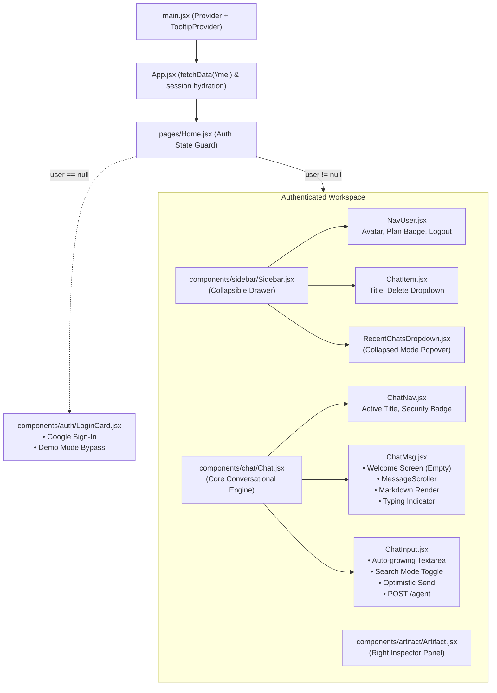
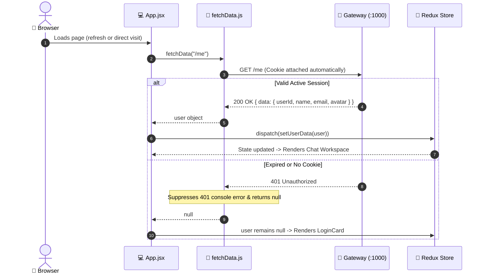
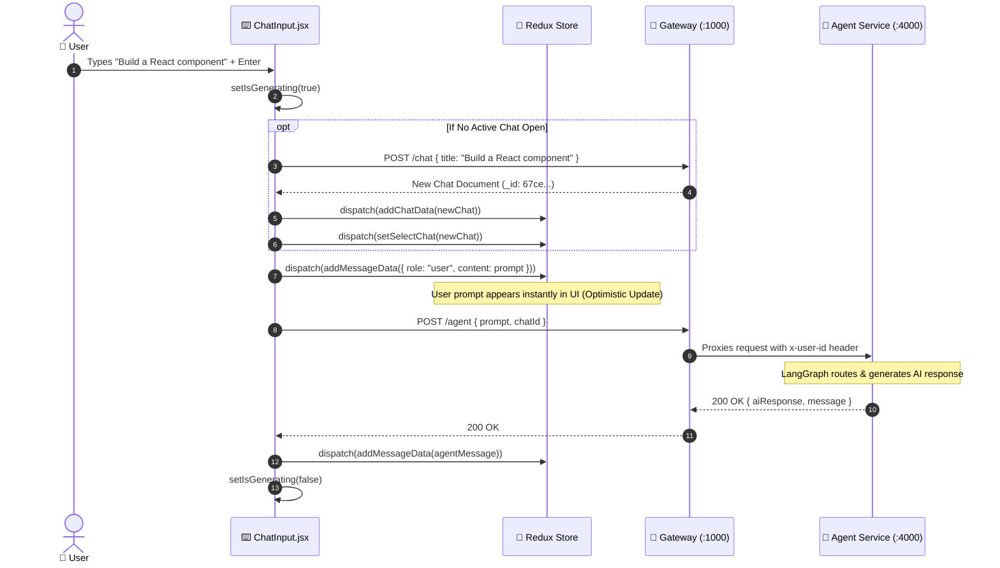

# Multi-Agent AI — Frontend Architecture & Code Flow Master Guide 💻🎨

> **Single Source of Truth** for the frontend architecture, component hierarchy, Redux Toolkit state machine, Firebase Google authentication flow, API integration with the API Gateway, UI design tokens, and engineering improvement roadmap.

---

## 📑 Table of Contents

1. [Architectural Overview & Philosophy](#-architectural-overview--philosophy)
2. [Frontend Component Hierarchy Diagram](#-frontend-component-hierarchy-diagram)
3. [Complete Directory & File Inventory](#-complete-directory--file-inventory)
4. [Redux Toolkit State Management](#-redux-toolkit-state-management)
   - [Store Configuration (`store.js`)](#1-store-configuration-storejs)
   - [User Slice (`userSlice.js`)](#2-user-slice-userslicejs)
   - [Chats Slice (`chatSlice.js`)](#3-chats-slice-chatslicejs)
   - [Messages Slice (`messageSlice.js`)](#4-messages-slice-messageslicejs)
5. [End-to-End Frontend Code Flows](#-end-to-end-frontend-code-flows)
   - [1. App Initialization & Session Recovery (`/me`)](#1-app-initialization--session-recovery-me)
   - [2. Firebase Google Authentication Flow](#2-firebase-google-authentication-flow)
   - [3. Thread Selection & History Hydration](#3-thread-selection--history-hydration)
   - [4. Sending Prompts & AI Agent Invocation](#4-sending-prompts--ai-agent-invocation)
   - [5. Thread Deletion & Cascading State Reset](#5-thread-deletion--cascading-state-reset)
6. [Component Architecture & UI Breakdown](#-component-architecture--ui-breakdown)
   - [Sidebar System (`Sidebar.jsx`, `ChatItem.jsx`, `NavUser.jsx`)](#1-sidebar-system)
   - [Chat System (`Chat.jsx`, `ChatNav.jsx`, `ChatMsg.jsx`, `ChatInput.jsx`)](#2-chat-system)
   - [Artifact Inspector (`Artifact.jsx`)](#3-artifact-inspector)
   - [Authentication & Demo Card (`LoginCard.jsx`)](#4-authentication--demo-card)
7. [Design Tokens & Styling System (Tailwind CSS v4)](#-design-tokens--styling-system-tailwind-css-v4)
8. [API Client Layer & Gateway Integration](#-api-client-layer--gateway-integration)
9. [Frontend Improvement & Optimization Roadmap](#-frontend-improvement--optimization-roadmap)

---

## 🎨 Architectural Overview & Philosophy

The frontend is a modern, responsive Single Page Application (SPA) designed to mirror state-of-the-art AI interfaces such as DeepSeek, Claude, and ChatGPT:

- **Core Tech Stack**: **React 19**, **Vite 8**, **Tailwind CSS v4**, **Redux Toolkit**, and **Geist Variable Font**.
- **Dark-Mode Aesthetic**: High-contrast, dark glassmorphic design (`#0d0f14`, `#161920`, `#22242a`) with subtle micro-animations, customizable scrollbars, and zero visual clutter.
- **Three-Column Spatial Layout**:
  - **Left**: Collapsible navigation drawer containing conversations, demo templates, and user profile management.
  - **Center**: Active conversation viewport with welcome state empty screens, markdown rendering, copy actions, and fixed input bar.
  - **Right**: Collapsible artifact panel for inspection of code, diagrams, and rich documents.
- **Client-Gateway Decoupling**: Frontend communicates strictly with the **API Gateway (`http://localhost:1000`)** with `withCredentials: true`. All cookies, sessions, and routing to Auth, Chat, or Agent microservices are handled transparently.

---

## 🗺️ Frontend Component Hierarchy Diagram



---

## 📁 Complete Directory & File Inventory

```text
frontend/
├── index.html                      # HTML5 entry with Geist Variable typography setup
├── package.json                    # Dependencies: React 19, Redux Toolkit, Vite 8, Tailwind v4
├── vite.config.js                  # Vite config with @tailwindcss/vite & path alias '@' -> './src'
├── components.json                 # Shadcn UI configuration
├── .env                            # VITE_SERVER_URL, VITE_FIREBASE_API_KEY
│
└── src/
    ├── main.jsx                    # React 19 root bootstrap with Redux Provider & TooltipProvider
    ├── App.jsx                     # Top-level shell: calls fetchData('/me') to restore user session
    ├── index.css                   # Tailwind v4 @import, Geist font, and OKLCH color design tokens
    │
    ├── pages/
    │   └── Home.jsx                # Switches between LoginCard and full 3-column Chat Workspace
    │
    ├── redux/                      # 🏬 Global State Management
    │   ├── store.js                # Configured Redux store combining user, chats, and messages
    │   └── slices/
    │       ├── userSlice.js        # State: { userData } (userId, name, email, avatar)
    │       ├── chatSlice.js        # State: { chatData, selectedChat } (threads list & active thread)
    │       └── messageSlice.js     # State: { messageData } (messages in active thread)
    │
    ├── features/                   # 🔌 Reusable API Feature Actions
    │   ├── fetchData.js            # Generic GET helper: suppresses 401s, unwraps res.data.data
    │   ├── createChat.js           # POST /chat: creates new conversation thread in MongoDB
    │   └── deleteChat.js           # DELETE /chat/:chatId: deletes thread & all messages
    │
    ├── components/
    │   ├── auth/
    │   │   └── LoginCard.jsx       # Google Sign-In card with error alert & demo mode bypass
    │   │
    │   ├── sidebar/
    │   │   ├── Sidebar.jsx         # Collapsible sidebar with New Chat button, user & demo lists
    │   │   ├── ChatItem.jsx        # Individual chat row with hover actions and delete modal
    │   │   ├── NavUser.jsx         # User profile card, initials fallback, upgrade plan, logout
    │   │   └── RecentChatsDropdown.jsx # Quick chat picker shown when sidebar is collapsed
    │   │
    │   ├── chat/
    │   │   ├── Chat.jsx            # Assembles ChatNav, messages/ChatMsg, and ChatInput
    │   │   ├── ChatNav.jsx         # Active thread title, pulsing online indicator, security badge
    │   │   ├── ChatInput.jsx       # Floating prompt box, web search toggle, send button
    │   │   └── messages/           # 📂 Message-specific components & Markdown engine
    │   │       ├── ChatMsg.jsx     # Master message viewport & MessageScroller orchestrator
    │   │       ├── UserMessage.jsx # Human prompt bubble (DeepSeek/ChatGPT style, no avatars)
    │   │       ├── AssistantMessage.jsx # AI response card (Markdown + GFM, copy toolbar)
    │   │       ├── CodeBlock.jsx   # Syntax highlighted code blocks with language badge & copy
    │   │       ├── ThinkingIndicator.jsx # Minimalist pulsing status indicator
    │   │       ├── ChatEmptyState.jsx    # Welcome empty screen with suggested prompt cards
    │   │       └── markdownComponents.jsx# Custom react-markdown + remark-gfm element mappings
    │   │
    │   ├── artifact/
    │   │   └── Artifact.jsx        # Right-hand inspector panel for code & generated documents
    │   │
    │   ├── icons/
    │   │   └── GoogleIcon.jsx      # Clean SVG Google brand icon
    │   │
    │   └── ui/                     # 🎨 22 Reusable Shadcn / Base UI Components
    │       ├── button.jsx          # CVA button variants (default, outline, ghost, destructive)
    │       ├── textarea.jsx        # Auto-resizing borderless chat input
    │       ├── message.jsx         # Base message bubble container
    │       ├── message-scroller.jsx# Smooth virtual scroller with scroll-to-bottom anchor
    │       ├── empty.jsx           # Empty state container for initial chat greeting
    │       ├── dropdown-menu.jsx   # Radix dropdown menu primitives
    │       ├── avatar.jsx          # Avatar with image loader and fallback initials
    │       └── badge.jsx, card.jsx, scroll-area.jsx, tooltip.jsx, etc.
    │
    ├── data/
    │   └── demoChats.js            # Curated interactive demo threads for instant exploration
    │
    └── utils/
        ├── axios.js                # Axios singleton with baseURL=localhost:1000 & credentials=true
        ├── axiso.js                # Typo-guard re-export of axios.js
        └── firebase.js             # Firebase Client SDK: GoogleAuthProvider with select_account
```

---

## 🏬 Redux Toolkit State Management

State is centrally coordinated through Redux Toolkit (`@reduxjs/toolkit`). This prevents prop-drilling and ensures instant reactivity across components.

### 1. Store Configuration (`store.js`)
```javascript
export const store = configureStore({
  reducer: {
    user: userReducer,
    chats: chatReducer,
    messages: messageReducer,
  },
});
```

### 2. User Slice (`userSlice.js`)
- **Initial State**: `{ userData: null }`
- **Actions**:
  - `setUserData(user)`: Sets active user object or `null` on logout.
- **Payload Schema**:
  ```json
  {
    "userId": "67cd6b819f01e194e82b75a1",
    "name": "Prince Sharma",
    "email": "prince@example.com",
    "avatar": "https://lh3.googleusercontent.com/..."
  }
  ```

### 3. Chats Slice (`chatSlice.js`)
- **Initial State**:
  ```javascript
  {
    chatData: [],        // Array of conversation objects (MongoDB + DEMO_CHATS)
    selectedChat: null,  // Active conversation object
  }
  ```
- **Actions**:
  - `setChatData(chats)`: Populates sidebar conversation list.
  - `addChatData(chat)`: Prepends newly created chat to top of list (`unshift`).
  - `setSelectChat(chat)`: Sets active conversation thread.
  - `deleteChatData(chatId)`: Filters out deleted chat and resets `selectedChat` to `null` if the deleted chat was currently open.

### 4. Messages Slice (`messageSlice.js`)
- **Initial State**: `{ messageData: [] }`
- **Actions**:
  - `setMessageData(messages)`: Replaces active thread message history.
  - `addMessageData(message)`: Appends a message (`push`) — used for optimistic user prompts and incoming AI responses.
  - `clearMessageData()`: Empties messages array when switching to a fresh or deleted thread.

---

## 🔄 End-to-End Frontend Code Flows

### 1. App Initialization & Session Recovery (`/me`)


---

### 2. Firebase Google Authentication Flow
1. User clicks **"Continue with Google"** on [`LoginCard.jsx`](file:///w:/Multi%20Agent%20AI/frontend/src/components/auth/LoginCard.jsx).
2. Triggers `signInWithPopup(auth, googleProvider)` using Firebase Client SDK.
3. Obtains Google JWT `token = await result.user.getIdToken()`.
4. Sends `POST http://localhost:1000/auth/login` with `{ token }`.
5. Gateway proxies to Auth Service (:2000), which returns user profile and sets HTTP-only `session` cookie in the browser.
6. Frontend dispatches `setUserData(userData)` $\rightarrow$ Screen instantly switches to workspace.

---

### 3. Thread Selection & History Hydration
1. User clicks a conversation item in the sidebar (`ChatItem.jsx`):
   ```javascript
   dispatch(setSelectChat(chat));
   ```
2. [`Chat.jsx`](file:///w:/Multi%20Agent%20AI/frontend/src/components/chat/Chat.jsx) listens to `selectedChat?._id` in `useEffect`:
   - If demo chat (`chat.isDemo`) $\rightarrow$ loads curated `chat.messages` directly.
   - If real chat $\rightarrow$ calls `fetchData(`/chat/${selectedChat._id}/messages`)`.
3. Dispatches `setMessageData(messages)`.
4. [`ChatMsg.jsx`](file:///w:/Multi%20Agent%20AI/frontend/src/components/chat/ChatMsg.jsx) renders the chronological message history.

---

### 4. Sending Prompts & AI Agent Invocation
When user presses Enter in [`ChatInput.jsx`](file:///w:/Multi%20Agent%20AI/frontend/src/components/chat/ChatInput.jsx):



---

### 5. Thread Deletion & Cascading State Reset
1. User opens dropdown on [`ChatItem.jsx`](file:///w:/Multi%20Agent%20AI/frontend/src/components/sidebar/ChatItem.jsx) and clicks **"Delete"**.
2. Component sets `isDeleting = true` and calls `deleteChat(chat._id)`.
3. Sends `DELETE http://localhost:1000/chat/:chatId`.
4. Upon backend confirmation:
   - Dispatches `deleteChatData(chat._id)` to remove it from sidebar list.
   - If the deleted chat was currently open $\rightarrow$ dispatches `clearMessageData()` to reset viewport to the welcome screen.

---

## 🧩 Component Architecture & UI Breakdown

### 1. Sidebar System

#### [`Sidebar.jsx`](file:///w:/Multi%20Agent%20AI/frontend/src/components/sidebar/Sidebar.jsx)
- **Collapsible Layout**: Toggles between expanded width (`w-65.25`) and compact mini-width (`w-12`).
- **Brand Identity**: Interactive logo that smoothly transitions to the toggle panel icon on hover.
- **Smart "New Chat" Action**: Dispatches `setSelectChat(null)` and `clearMessageData()` to present a clean welcome screen without littering MongoDB with empty rows.
- **Section Categorization**: Divides conversations into **Recent** (authenticated user threads) and **Demo Chats** (curated templates).

#### [`ChatItem.jsx`](file:///w:/Multi%20Agent%20AI/frontend/src/components/sidebar/ChatItem.jsx)
- Displays truncated conversation title.
- Highlights active selection with `bg-white/10 text-white font-medium`.
- Hover-activated actions menu with Radix DropdownMenu containing the **Delete** action with loading spinner.

#### [`NavUser.jsx`](file:///w:/Multi%20Agent%20AI/frontend/src/components/sidebar/NavUser.jsx)
- Displays user avatar with Google image URL.
- Fallback initials badge using `getInitials(user.name)` (e.g., "Prince Sharma" $\rightarrow$ "PS").
- Profile menu containing **Upgrade Plan**, **Settings**, and **Log out** (calls `POST /auth/logout`).

#### [`RecentChatsDropdown.jsx`](file:///w:/Multi%20Agent%20AI/frontend/src/components/sidebar/RecentChatsDropdown.jsx)
- When the sidebar is collapsed into mini mode, clicking the message icon opens a floating popover displaying recent conversations with inline delete support.

---

### 2. Chat System

#### [`Chat.jsx`](file:///w:/Multi%20Agent%20AI/frontend/src/components/chat/Chat.jsx)
The primary layout coordinator. Combines the header ([`ChatNav`](file:///w:/Multi%20Agent%20AI/frontend/src/components/chat/ChatNav.jsx)), message container ([`ChatMsg`](file:///w:/Multi%20Agent%20AI/frontend/src/components/chat/ChatMsg.jsx)), and input bar ([`ChatInput`](file:///w:/Multi%20Agent%20AI/frontend/src/components/chat/ChatInput.jsx)) within an absolute vertical flex container.

#### [`ChatMsg.jsx`](file:///w:/Multi%20Agent%20AI/frontend/src/components/chat/ChatMsg.jsx)
Handles two distinct interface states:
1. **Welcome Empty State (`<Empty />`)**:
   - Displays SarthiAi gradient emblem.
   - Headline: *"How can SarthiAi help you today?"*.
   - 3 interactive prompt cards: **Build a Web App**, **Brainstorm Ideas**, **Explain a Concept**. Clicking any card populates the prompt input.
2. **Message Scroller Viewport (`<MessageScroller />`)**:
   - Clean DeepSeek/Claude message style without noisy avatars.
   - **User Bubbles**: Compact right-aligned dark slate cards (`bg-[#212631]`).
   - **AI Assistant Responses**: Full-width Markdown render (`<Markdown />`), supporting headers, codeblocks, lists, and bold text.
   - **Hover Action**: Instant copy button with visual checkmark feedback (`copiedId`).
   - **Generation Status**: Animated 3-dot bouncing typing indicator when `isGenerating === true`.
   - **Floating Anchor Button**: `<MessageScrollerButton />` appears when scrolled up to jump down to the latest message.

#### [`ChatInput.jsx`](file:///w:/Multi%20Agent%20AI/frontend/src/components/chat/ChatInput.jsx)
Styled after DeepSeek's modern floating pill container:
- **Rounded Container**: `rounded-[26px] bg-[#22242a] p-3.5 shadow-xl`.
- **Borderless Textarea**: Auto-expanding textarea (`min-h-11 max-h-36`) with hidden scrollbar.
- **Keybindings**: Pressing `Enter` (without `Shift`) triggers `handleSend()`. `Shift + Enter` inserts a newline.
- **Controls Bar**:
  - **Search Button**: Toggles web search augmentation (`setWebSearch`).
  - **Attachment / Mic**: UI placeholders for multimodal uploads and voice transcription.
  - **Send Button**: Blue circular button (`bg-[#3e5cd6]`) enabled only when non-empty text exists.

---

### 3. Artifact Inspector

#### [`Artifact.jsx`](file:///w:/Multi%20Agent%20AI/frontend/src/components/artifact/Artifact.jsx)
- Positioned as the third column on large screens (`hidden lg:flex w-72 xl:w-80`).
- Dedicated space for displaying code files, interactive HTML/CSS previews, Mermaid diagrams, or exported reports generated by specialist agents.

---

### 4. Authentication & Demo Card

#### [`LoginCard.jsx`](file:///w:/Multi%20Agent%20AI/frontend/src/components/auth/LoginCard.jsx)
- Centered card with Google brand button (`GoogleIcon.jsx`).
- Handles popup cancellation gracefully.
- Includes **"Explore Demo Workspace"** shortcut for instant testing without signing in.

---

## 🎨 Design Tokens & Styling System (Tailwind CSS v4)

Configured in [`frontend/src/index.css`](file:///w:/Multi%20Agent%20AI/frontend/src/index.css) using native Tailwind CSS v4 `@theme inline` and modern **OKLCH** color spaces:

```css
@import "tailwindcss";
@import "@fontsource-variable/geist";
@import "tw-animate-css";
@import "shadcn/tailwind.css";

@theme inline {
  --font-sans: 'Geist Variable', sans-serif;
  --color-background: var(--background);
  --color-foreground: var(--foreground);
  --color-primary: var(--primary);
  --color-destructive: var(--destructive);
  --radius-lg: var(--radius);
}
```

### Color Palette Strategy
- **Workspace Canvas**: `#0d0f14` (ultra-deep matte charcoal).
- **Sidebar Surface**: `#0d0f14` with subtle `border-white/6`.
- **Card & Component Surfaces**: `#161920` and `#22242a`.
- **Interactive Accents**: `#3e5cd6` (electric indigo) and `#10b981` (emerald green).
- **Typography**: `Geist Variable`, providing crisp geometric readability at small UI scales.

---

## 📡 API Client Layer & Gateway Integration

The frontend uses an Axios singleton in [`frontend/src/utils/axios.js`](file:///w:/Multi%20Agent%20AI/frontend/src/utils/axios.js):

```javascript
import axios from "axios";

const api = axios.create({
  baseURL: import.meta.env.VITE_SERVER_URL || "http://localhost:1000",
  withCredentials: true,
});

export default api;
```

### Feature Helper Modules (`src/features/`)

| Helper File | Method & Endpoint | Responsibility | Return Value |
| :--- | :--- | :--- | :--- |
| [`fetchData.js`](file:///w:/Multi%20Agent%20AI/frontend/src/features/fetchData.js) | `GET <url>` | Generic fetcher; suppresses expected 401s, returns `res.data.data` | Unwrapped data object or `null` |
| [`createChat.js`](file:///w:/Multi%20Agent%20AI/frontend/src/features/createChat.js) | `POST /chat` | Creates a new chat thread in MongoDB | New `Chat` object |
| [`deleteChat.js`](file:///w:/Multi%20Agent%20AI/frontend/src/features/deleteChat.js) | `DELETE /chat/:chatId` | Permanently deletes a thread & cascading messages | `true` if deleted, `false` on error |

---

## 🚀 Frontend Improvement & Optimization Roadmap

### Phase 1: Markdown Syntax Highlighting & Tables
- **Current State**: Uses `<Markdown>{msg.content}</Markdown>` without code syntax highlighting.
- **Improvement**:
  - Add `remark-gfm` (already in `package.json`) as a plugin:
    ```jsx
    <Markdown remarkPlugins={[remarkGfm]}>{msg.content}</Markdown>
    ```
  - Integrate Prism or `react-syntax-highlighter` to format code blocks with copy-code buttons and language badges.

### Phase 2: Live Token Streaming (SSE / WebSockets)
- **Current State**: Waits for the full agent response before rendering.
- **Improvement**:
  - Replace `api.post("/agent")` with a streaming client using `fetch()` and `ReadableStreamDefaultReader` or `EventSource`.
  - Update `message.content` incrementally for a fluid, real-time typewriter effect.

### Phase 3: Interactive Artifact Inspector Integration
- **Current State**: [`Artifact.jsx`](file:///w:/Multi%20Agent%20AI/frontend/src/components/artifact/Artifact.jsx) displays static text `"No active artifact"`.
- **Improvement**:
  - Add an `artifactSlice` to Redux.
  - When the AI generates HTML, SVGs, code, or charts, automatically parse artifacts and render live previews in the right-hand panel.

### Phase 4: Voice & Multimodal File Uploads
- **Current State**: Attachment and Mic buttons in `ChatInput.jsx` are UI placeholders.
- **Improvement**:
  - Wire attachment input to allow image/PDF uploads to the backend.
  - Wire microphone button to Web Speech API or Whisper transcription.
